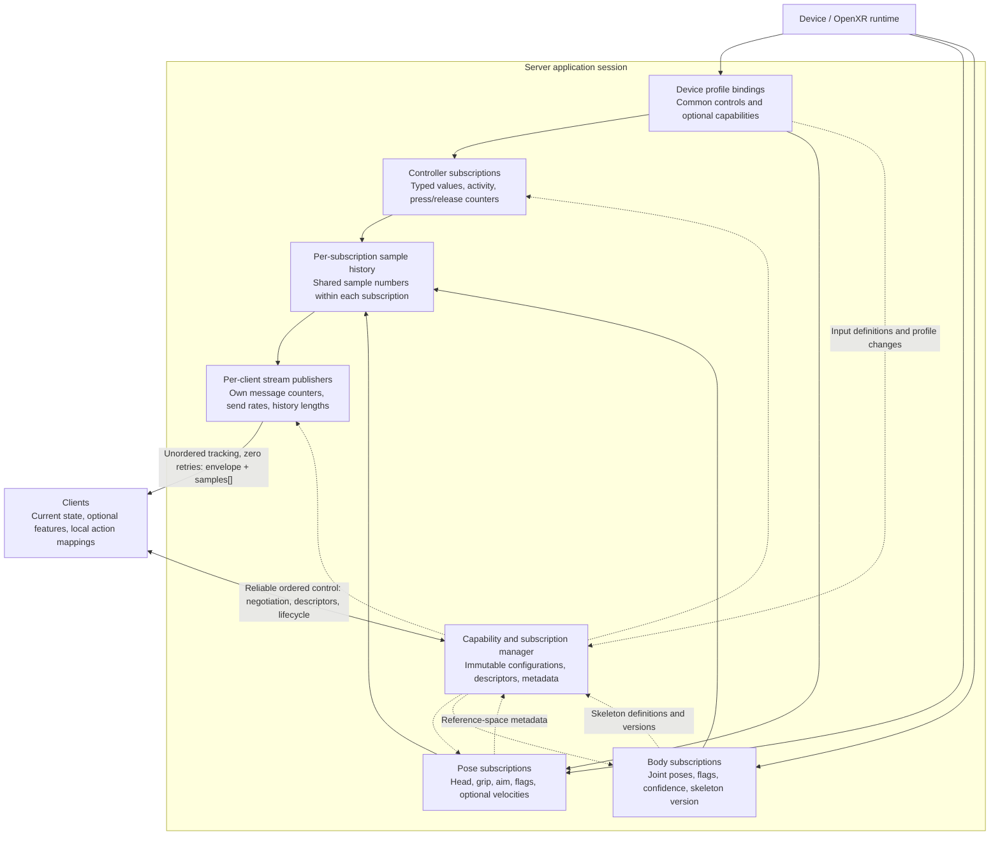

# Tracking protocol design

This document describes the intended protocol for publishing OpenXR tracking
from the device application to WebRTC clients, initially on Quest. It defines
responsibilities, negotiation, data semantics, and delivery behavior. Unresolved
wire formats, defaults, and target-device limits are listed under
[open decisions and validation](#open-decisions-and-validation).

The priority is fresh input with low latency. Clients must be able to use newer
samples immediately without waiting for missing messages. The three tracking
streams are **controller**, **pose**, and **body**.

## Architecture and responsibilities

The server maps device interaction profiles to stable, typed protocol controls.
Clients consume those controls through a common interface and map them to
application actions locally. Optional capabilities use the same discovery,
selection, and snapshot mechanisms as common controls; clients do not need
device-specific binding paths for ordinary interaction.

A **server subscription** acquires one kind of tracking data under an immutable
configuration. Multiple clients can consume the same subscription and share its
numbered samples. A different acquisition configuration uses a different
subscription. A **client stream** publishes those samples to one client using
that client's send rate, history length, and message counter. Application action
mappings can differ between clients consuming the same subscription.

The history node represents separate buffers for separate subscriptions. Sample
numbers are not shared between controller, pose, and body subscriptions. The
client stream is a logical publication; several logical streams can use one
tracking data channel on a client's WebRTC connection.

Shared client support handles descriptor interpretation, current-state updates,
sample deduplication, counter differences, activity and staleness, and access to
optional capabilities. It provides default application action mappings with
local overrides. Exact control names and default mappings remain to be defined.

## Reliability and channels

| Channel | Delivery | Contents |
| --- | --- | --- |
| Control | Reliable, ordered | Capabilities; subscribe, unsubscribe, and configuration requests; accepted settings or rejection reasons; subscription descriptors and stream associations; versioned skeleton/reference-space metadata; subscription lifecycle notifications |
| Tracking | Unordered, zero data-message retransmissions | Independent snapshots in a `samples` array, with stream, subscription, message, and sample identifiers; clock-sync probes as a separate message type |

For tracking, use the equivalent of `ordered: false` and `maxRetransmits: 0`.
Ordering and reliability are independent options: unordered delivery alone does
not disable retransmission. There are no per-snapshot acknowledgements, requests
for missing tracking messages, or delta chains that require an earlier message.
See [WebRTC data-channel delivery modes](https://www.rfc-editor.org/rfc/rfc8831.html#section-6.1).

Control data is relatively infrequent and determines how samples are interpreted,
so reliable delivery is appropriate. Reliability applies to the live connection;
after reconnecting, the client establishes subscriptions and metadata again.

Separate channels do not provide complete transport isolation. SCTP streams on
the same association share congestion control. Keep control messages bounded,
avoid large transfers alongside tracking, and do not build a queue of obsolete
snapshots. Replace pending application snapshots with the latest available data
before handing them to the transport. Monitor send buffering and reduce or skip
publications when necessary. Zero retransmissions does not guarantee a maximum
delivery delay. See [SCTP congestion control](https://www.rfc-editor.org/rfc/rfc8831.html#section-5)
and [WebRTC send buffering](https://www.w3.org/TR/webrtc/#dom-rtcdatachannel-bufferedamount).

## Capabilities and subscription lifecycle

The operational flow is connection, discovery, subscription negotiation,
descriptor delivery, then snapshot consumption. Control requests carry request
identifiers and receive explicit accepted or rejected results. Operation names
and message layouts remain wire-format decisions.

### Connect and discover

Establish the WebRTC connection and its control and tracking channels. Negotiate
a mutually supported protocol version before processing subscription requests;
report incompatibility if there is no common version. The server identifies its
application session and publishes capabilities over control.

Capability discovery describes what the server can expose through its supported
bindings and runtime configuration. It includes:

- Available stream kinds and sources, with controller inputs described per hand.
- Input identifiers, types, meanings, ranges or units, and available optional
  features. Device profile information supplements these stable definitions.
- Supported acquisition settings, reference spaces, joint sets, and fidelity
  preferences, together with applicable permission or availability restrictions.
- Publication, history-retention, and message-size limits.

Do not infer an exhaustive hardware input inventory from an OpenXR profile or
extension name. Advertised capabilities must reflect the server's implemented
bindings and runtime support. Keep these three concepts separate:

| Concept | Meaning |
| --- | --- |
| Supported | The server can expose the capability under the current runtime configuration |
| Selected | The accepted subscription includes it in its descriptor and snapshots |
| Active | The current sample has a contributing input source; temporary inactivity does not remove a selected input |

Pose validity and tracking flags provide additional per-sample information; a
capability announcement alone never establishes tracking validity.

### Request and resolve subscriptions

A request identifies the stream kind and sources, required and optional
capabilities, acquisition settings, and per-client publication settings. Resolve
omitted settings to defined defaults before comparing acquisition configurations.

- Reject requests whose required capabilities cannot be provided, with reasons.
- Omit unavailable optional capabilities and explicitly list those omissions in
  the result. Required inputs may be temporarily inactive; requiring support is
  not a guarantee of continuous activity.
- Reject unsupported configuration values with available alternatives rather
  than silently substituting settings. Runtime quality preferences remain
  preferences, as described for the relevant stream.
- Return all resolved settings explicitly, including selected inputs and their
  interpretation. Acceptance does not guarantee physical sensor frequency,
  current validity, or actual tracking fidelity.

The configuration scopes are:

| Scope | Settings | Policy |
| --- | --- | --- |
| Per-client publication | Send rate, history length | Independent, within advertised limits; no subscription change |
| Shared acquisition | Stream kind, selected sources and inputs, sample rate, base space, target-time policy, joint set, Boolean interpretation | Equal resolved configurations share a subscription |
| Server policy | User calibration, display-refresh preference, resource budget | Not implicitly overwritten by a client subscription request |

Required/optional preferences belong to the client's request; the shared
acquisition configuration contains the resolved selection. Clients with different
preferences can therefore share the same subscription when the resulting
configuration is equal. Client application action mappings do not affect that
comparison.

Reuse an existing subscription with an equal resolved acquisition configuration.
Otherwise create a separate subscription if the runtime and server budget permit
it, or reject with a reason and available alternatives. Do not silently alter
another client's configuration or merge conflicting requests by choosing the
largest rates or feature sets. Distinct logical subscriptions need not duplicate
compatible underlying OpenXR resources.

### Describe and start streams

On acceptance, send the client stream identity, its subscription association, a
complete shared subscription descriptor, and that client's publication settings.
The descriptor contains the resolved acquisition configuration, selected data
definitions, payload layout, units and coordinate conventions, clock semantics,
and references to required versioned metadata. Deliver the corresponding
skeleton and reference-space definitions over control as well.

Control-channel ordering does not extend to tracking messages on another channel.
A snapshot can arrive before its descriptor or required metadata, even if the
server sent that metadata first. Receiver behavior is:

1. Consume samples only when the subscription is associated with the client
   stream and its descriptor and required metadata are known.
2. Discard samples with unknown subscriptions, associations, or metadata; rely on
   reliable control delivery and subsequent fresh samples. Do not stall tracking.
3. Only control messages change stream associations. A late tracking message
   must never switch a stream back to a previous subscription.
4. Preserve versioned metadata while needed to interpret retained history.

Publication does not wait for a subscription-ready acknowledgement. Freshness,
history deduplication, and gap handling follow the
[snapshot delivery rules](#snapshot-delivery).
See [ordering within SCTP streams](https://www.rfc-editor.org/rfc/rfc8831.html#section-6.3).

### Change, disconnect, and reconnect

Publication-setting updates affect only the requesting client's stream. A change
to acquisition settings, selected data, or its interpretation moves that stream
to another matching or newly created subscription. Its `streamId` and message
counter can continue across the switch. Send the destination descriptor,
metadata, and stream association over control using the same rules as initial
subscription. Other clients remain on their existing subscriptions.

Report runtime capability and profile changes over control. Temporary input
inactivity is represented in snapshots and does not itself change the subscription.
If changed capabilities require a different resolved configuration or data
interpretation, use an explicit subscription switch. If required capabilities
can no longer be provided, report their loss rather than silently downgrading
the request. Recovery and automatic renegotiation policy remain open decisions.

The server must not mutate a subscription's acquisition configuration in place.
This applies to server-initiated changes as well as client requests. Runtime
skeleton or reference-space metadata changes retain their own versions when the
acquisition configuration stays the same.

Unsubscription or disconnection detaches that client's streams without destroying
subscriptions still used by others. Retire unused subscriptions without reusing
their IDs within the server session. On reconnect, negotiate again, establish new
client streams, obtain descriptors and metadata, and baseline current state and
counters. Rejoining a retained shared subscription does not reset its samples or
counters. An application restart changes `serverSessionId` and invalidates prior
session identities and clock mappings.

## Tracking data

### Controller

#### Input model and device bindings

Publish per-hand controls with stable protocol meanings and Boolean, scalar, or
two-dimensional types. Common control roles support portable application input;
optional controls extend that vocabulary without changing the common meanings.
Clients select capabilities rather than writing OpenXR bindings for each device.
Use vendor-qualified identifiers when a capability has no shared protocol
meaning. A type and range alone are insufficient to establish equivalent
semantics across devices; unfamiliar controls can be ignored or inspected
without assigning application behavior to them.

OpenXR actions are defined by the server application and bound to interaction
profile components. Prepare the supported actions and suggested bindings during
XR initialization, before attaching action sets to the session. Network
subscriptions select from this prepared input model; they do not dynamically
create arbitrary OpenXR actions. Attached action sets are immutable and can be
attached only once per session. See
[action-set attachment](https://registry.khronos.org/OpenXR/specs/1.1/man/html/xrAttachSessionActionSets.html).

Provide bindings for tested device profiles that cover common controls and
available extras. Use the Khronos generic controller profile as a fallback when
the runtime supports it. The generic profile covers common buttons, trigger,
squeeze, thumbstick, and poses, but does not include touch, finger proximity,
curl, or slide. Portable protocol controls can be supplied through device
profiles as well as the generic profile. See the
[generic controller specification](https://raw.githubusercontent.com/KhronosGroup/OpenXR-Docs/main/specification/sources/chapters/extensions/khr/khr_generic_controller.adoc).

Report the active interaction profile per hand as source information. A runtime
may emulate a profile, and a reported profile does not establish controller
presence or current input activity. Clients use negotiated control definitions
and sample activity rather than inferring capabilities from the profile name.
See [current interaction profiles](https://registry.khronos.org/OpenXR/specs/1.1/man/html/xrGetCurrentInteractionProfile.html).

#### Data and availability

The controller inventory covers the following data where supported and selected:

| Control group | Data |
| --- | --- |
| Trigger | Analog activation, Boolean activation with defined interpretation, touch state |
| Squeeze/grip | Analog activation and Boolean activation with defined interpretation |
| Thumbstick | Two axes, click state, touch state |
| Face buttons | Primary/secondary click and touch states per hand, with device labels as metadata |
| Thumbrest and menu | Thumbrest touch and application-accessible menu input |
| Optional finger sensing | Thumb/index proximity, index curl and slide |
| Optional trigger force | Normalized additional pressure after the end of trigger travel |

Not every control is available on every device. Touch Plus proximity is Boolean;
curl and slide are normalized scalar signals rather than physical distances.
Curl describes index-finger posture, and slide describes movement along the
trigger surface. The system button may be unavailable to applications. See the
[Touch Plus interaction profile](https://raw.githubusercontent.com/KhronosGroup/OpenXR-Docs/main/specification/sources/chapters/extensions/meta/meta_touch_controller_plus.adoc).

The descriptor defines the selected controls, their types, ranges or units, and
meanings. Every snapshot represents every selected control, including its
activity. Unsupported or unselected inputs are absent from the descriptor;
selected but inactive inputs remain represented as inactive. Neither case is a
valid zero or released state, and absence never means an unchanged delta value.

Each exposed Boolean input carries its current state, `isActive`, and cumulative
`pressCount`/`releaseCount`. These count observed false-to-true and true-to-false
transitions; for touch/proximity inputs the same convention describes entering
and leaving that state. Analog inputs carry their value and activity. Preserve
runtime change timestamps where valid and available, with the time conversion
defined below.

Any Boolean derived from an analog input is evaluated during acquisition so
its transitions can be counted independently of publication rate. Its conversion
or threshold/hysteresis definition belongs in the acquisition configuration.
Changing that definition requires a different subscription; changing a client's
local mapping from controls to application actions does not.

#### Transition counters

Update counters when acquiring input, independently of network publication.
Counters are scoped to the server subscription and shared by all its clients.
Keep publishing current values and counts even when unchanged. Later snapshots
then let clients recover counts of observed transitions missing from their
received snapshots, including complete presses and releases that leave the
current state unchanged.

Compare counters between accepted live snapshots; do not sum counter changes
again from overlapping history. The first received sample establishes a baseline
when a client attaches to or switches subscriptions, rather than replaying
historical presses. Attaching or detaching clients does not reset server counters.

Activity loss and reacquisition are status changes, not fabricated button edges.
Rebaseline the server's Boolean state when an input becomes active again without
incrementing or resetting the cumulative counters. Counts report observed
transitions; they do not preserve exact event timing or ordering across inputs.

The publisher can only count transitions it observes. OpenXR action state is
synchronized state, not a queue of all hardware transitions.
`changedSinceLastSync` must not be treated as a client-specific delivery flag.
See [action synchronization](https://registry.khronos.org/OpenXR/specs/1.1/man/html/xrSyncActions.html)
and [Boolean action state](https://registry.khronos.org/OpenXR/specs/1.1/man/html/XrActionStateBoolean.html).

### Pose

Publish headset/view pose and left/right controller grip and aim poses, selected
by the acquisition configuration. Each located pose includes:

- Position and orientation.
- Separate position/orientation validity and tracking flags.
- Optional linear/angular velocities and their validity flags.
- Target time and a reference-space identifier/version.
- Source activity where supplied by the action API.

Validity and active tracking are distinct: an inferred or last-known pose can
remain valid after active tracking is lost. Base space and target time are
acquisition choices. Advertise available pose sources, reference spaces, and
optional velocity support through capability discovery.
See [space location](https://registry.khronos.org/OpenXR/specs/1.1/man/html/xrLocateSpace.html),
[velocity data](https://registry.khronos.org/OpenXR/specs/1.1/man/html/XrSpaceVelocity.html),
and [reference-space changes](https://registry.khronos.org/OpenXR/specs/1.1/man/html/XrEventDataReferenceSpaceChangePending.html).

### Body

Publish the selected joint set, joint positions/orientations, per-joint location
flags, overall activity/confidence, returned tracking time, and skeleton version.
Include actual fidelity and calibration status when their extensions are
available. Joint poses are expressed in the selected base space, not implicitly
relative to parent joints.

Acquisition choices, subject to runtime and extension support, include the
default 70-joint set or full 84-joint set, reference space, target time, and
fidelity preference. Advertise the available choices during discovery. Skeleton
definitions contain joint IDs, parent IDs, and T-pose geometry; deliver them over
control on subscription and whenever skeleton proportions change. Reference the
appropriate skeleton version in each sample. Automatic skeleton changes do not
change the requested acquisition configuration or require a new subscription.
Skeleton and reference-space metadata keep their own versions because they can
change while the acquisition configuration remains fixed.

The base API does not provide numeric per-joint confidence or joint velocities.
Body output includes estimated motion; full-body output can include generative
legs. Requested high fidelity is a preference, not a guarantee of actual quality.
See [body samples](https://registry.khronos.org/OpenXR/specs/1.1/man/html/XrBodyJointLocationsFB.html),
[joint data](https://registry.khronos.org/OpenXR/specs/1.1/man/html/XrBodyJointLocationFB.html),
[skeleton retrieval](https://registry.khronos.org/OpenXR/specs/1.1/man/html/xrGetBodySkeletonFB.html),
[Meta body tracking](https://developers.meta.com/vr/documentation/unity/move-body-tracking/),
and [fidelity requests](https://registry.khronos.org/OpenXR/specs/1.1/man/html/xrRequestBodyTrackingFidelityMETA.html).

## Snapshot delivery

### Identity and numbering

| Field | Scope and meaning |
| --- | --- |
| `serverSessionId` | Identifies this server application session; changes on application restart |
| `subscriptionId` | Identifies a shared server acquisition subscription and its immutable configuration within that session |
| `sampleNumber` | Increases once per application-acquired sample within a subscription; identical for every client receiving that sample |
| `streamId` | Identifies one client's publication stream; a recreated stream gets a new identity |
| `messageNumber` | Increases once per message accepted for sending on that client stream; continues when the stream switches subscriptions |

A sample's identity is
`(serverSessionId, subscriptionId, sampleNumber)`. A message's
identity is `(serverSessionId, streamId, messageNumber)`.

Assign sample numbers at acquisition time. Repeating a sample in history preserves
its number and contents. A newly created subscription starts a new sample-number
sequence; attaching another client to an existing subscription does not reset it.
Never compare sample numbers across subscriptions. Message numbers are per client
stream, not global across the client's controller, pose, and body streams.

Assign message numbers when the transport accepts a publication for sending.
Skipping a scheduled send, or replacing an unsent application message, must not
consume a message number. A synchronous send rejection must not create a gap.
Acceptance does not prove delivery: subsequent transport abandonment or network
loss still produces a missing message at the receiver.

These counters distinguish two observations:

- A **message-number gap** means a publication has not been received. It may be
  lost, abandoned, or merely reordered. Continue without waiting to resolve it.
- A **sample-number gap** means intermediate application samples are absent from
  the received data. It can result from publication rate, insufficient history,
  or missing messages. Inspect all sample numbers in the history, not just the
  newest number, when measuring sample coverage.

Sample numbers do not count physical sensor updates or reveal updates that
OpenXR never exposed. Device update rate, application acquisition rate, and client
publication rate are separate quantities.

### Snapshot contents and history

Each tracking message has an envelope and a **nonempty `samples` array**, even
when it contains only one snapshot. The envelope identifies the server session,
client stream, shared subscription, and message number. Every sample contains
its sample number, acquisition timestamp, and a complete snapshot of the
subscription's selected data. Unchanged values remain present; decoding does
not depend on a previously received sample.

The descriptor identifies the payload kind and its layout. Each sample includes
the timing and metadata references needed for that kind. `acquiredAt` describes
application acquisition; pose target time and body returned time are separate
values, not assumed to equal acquisition time. All use the server clock domain
defined in [Timestamping and clock synchronization](#timestamping-and-clock-synchronization);
clients must map server timestamps before comparing them with their local clock.

`historyLength` is a per-client publication setting, with a minimum and default
of **1**. It counts the newest snapshot as well as any older samples included.

- Include up to `historyLength` most recent consecutive acquisition samples,
  ordered oldest to newest, ending with the latest available sample.
- Use acquisition history, not just previously published samples.
- Never delay publication to fill history. Send fewer samples while a new
  subscription's history is filling. Accept larger history requests only within
  advertised retention and message-size limits; discarded history cannot be
  restored.
- A message contains samples from only one subscription. When a stream switches
  subscriptions, use the destination subscription's history without mixing in
  samples from the previous subscription.
- Publishing more slowly than acquiring can leave gaps if history is too short
  to cover the intervening samples. The default of 1 intentionally permits this.

When history overlaps, duplicate samples are intentional. This is **proactive
repetition**, not retransmission triggered by loss or an acknowledgement. It
spends bandwidth to improve recovery without waiting a round trip. A finite
history cannot guarantee recovery through a longer outage.

### Client consumption

For live control, apply only a sample newer than the latest applied sample in the
active subscription. A history consumer can separately deduplicate and
retain older, previously unseen samples. Reordered messages must never roll back
live state. Message numbers track publication gaps; sample numbers determine
sample freshness and deduplication.

Expose current Boolean state separately from counter differences. Process each
advance once, using the baseline and activity rules in
[transition counters](#transition-counters). Do not infer exact event timing or
cross-input ordering from cumulative counts. Applications decide whether
recovered transitions are still useful for their current interaction.

Invalidate inactive input and expire stale state when updates stop. Client-side
cancellation of an interaction is distinct from an observed device release and
must not alter the server's transition counts. Staleness timing is a client
policy whose defaults remain to be defined.

## Timestamping and clock synchronization

### Server clock domain

Publish all server timestamps in one domain, `server-monotonic`, represented as
signed 64-bit integer nanoseconds. On Quest, this is the value of
`CLOCK_MONOTONIC`, with `tv_sec * 1_000_000_000 + tv_nsec` as the timestamp.
The origin is opaque: it is not UTC or time since application startup. Nanosecond
units describe the representation, not a guarantee of resolution or accuracy.
Clock semantics belong in the descriptor and apply across all subscriptions and
clients in the server session.

| Timestamp | Meaning and source |
| --- | --- |
| `acquiredAt` | Application acquisition time, read from `CLOCK_MONOTONIC`; not necessarily physical sensor capture time |
| Pose target time | The time requested from OpenXR, converted to `server-monotonic`; may be later than acquisition time for predicted poses |
| Body returned time | The time returned by the body-tracking runtime, converted to `server-monotonic` |
| Input-change time | The runtime's change time, where valid and available, converted to `server-monotonic` |
| Clock-sync receive/send times | Application receive/send times, read from `CLOCK_MONOTONIC` |

Use `xrConvertTimeToTimespecTimeKHR` from `XR_KHR_convert_timespec_time` for each
relevant OpenXR timestamp. Check extension support and conversion results;
unavailable or invalid runtime timestamps must not be published as valid times.
Do not reinterpret `XrTime` as a system timestamp or cache a fixed offset between
the two clocks. OpenXR does not guarantee that their relationship stays constant.
See the [conversion API](https://registry.khronos.org/OpenXR/specs/1.1/man/html/xrConvertTimeToTimespecTimeKHR.html)
and [OpenXR time guarantees](https://registry.khronos.org/OpenXR/specs/1.1/man/html/XrTime.html).

The server publishes the same sample timestamps to every client. Conversion into
a client's local timeline, including offset, drift, and uncertainty estimation,
is entirely the client's responsibility. Neither endpoint needs to adjust its
operating system clock. Scope each client mapping to `serverSessionId`; establish
a new mapping when the session changes, even if the underlying system clock has
continued running.

`CLOCK_MONOTONIC` does not jump when wall-clock time is set, but its rate can be
adjusted and it excludes system suspend time. Re-establish the mapping after
either endpoint suspends/resumes. If a connection survives headset suspend, the
server should notify clients of resume over control so they can invalidate the
old mapping. See [Linux clock semantics](https://man7.org/linux/man-pages/man2/clock_gettime.2.html).

Wire encoding remains undecided but must preserve the integer timestamps exactly.
TypeScript clients should retain them as `bigint` and subtract a nearby reference
before converting differences to floating-point milliseconds. If using JSON,
encode 64-bit timestamps as decimal strings rather than JSON numbers.

### Client clock synchronization

Use a four-timestamp, NTP-style exchange over the existing unordered,
zero-retry tracking data channel. Probes are small, bidirectional messages of a
distinct type, not tracking snapshots; they do not consume sample/message
counters or enter sample history. Match replies by a request ID. A lost probe can
be skipped without retransmission or delaying tracking.

1. The client records `t1` on its local monotonic clock and sends a request,
   retaining `t1` under the request ID.
2. The server records receive time `t2` in `server-monotonic`.
3. The server records `t3` immediately before sending a response containing
   `serverSessionId`, the request ID, `t2`, and `t3`.
4. The client records local receive time `t4` and matches the response to `t1`.

Record timestamps as close to application send/receive boundaries as possible,
before unrelated work. These are application timestamps, not hardware packet
timestamps; transport queues and callback scheduling still affect the exchange.
The server does not need to know the client's clock origin or calculate a mapping.
Browser clients can use `performance.now()`; native clients can use their local
monotonic clock. Express all four values in consistent units before calculation.

For approximately equal clock rates during the exchange:

| Quantity | Calculation |
| --- | --- |
| Offset, server time minus client time | `((t2 - t1) + (t3 - t4)) / 2` |
| RTT excluding server processing | `(t4 - t1) - (t3 - t2)` |
| Approximate client time for a server timestamp | `serverTimestamp - offset` |

This is the [NTP offset/delay calculation](https://www.rfc-editor.org/rfc/rfc5905.html#section-8).
It assumes approximately symmetric outbound and return delays. RTT alone does
not determine clock offset, and repeated probes cannot distinguish persistent
path asymmetry from clock offset. WebRTC's media synchronization and RTT
statistics do not automatically map timestamps in data-channel payloads.
See [WebRTC data-channel transport](https://www.rfc-editor.org/rfc/rfc8831.html#section-1)
and [remote clock statistics](https://www.w3.org/TR/webrtc-stats/#dom-rtcremoteoutboundrtpstreamstats-remotetimestamp).

The client maintains the mapping through repeated probes, favoring recent low-RTT
exchanges and rejecting invalid or delayed outliers. Account for relative clock
rate over time as well as offset, and track estimate age and uncertainty. A low
RTT is not proof of symmetric delays or a particular synchronization accuracy.
Refresh after reconnects or path changes, and discard exchanges spanning a
suspend, clock reset, or session change. Estimator tuning and probe cadence remain
open decisions.

Synchronization must not stall sample delivery. A client can still order samples
by their identifiers before a mapping is available, but must treat local sample
age or one-way latency as unknown until it has a usable mapping. Subtracting a
predicted pose target time from arrival time does not measure acquisition latency.

## Open decisions and validation

The behavior above defines the design direction. The following details are not
fixed by this document:

- Wire encoding, exact control and descriptor schemas, version-negotiation
  messages, non-timestamp numeric widths, and rollover rules.
- Canonical control identifiers and normalization rules, device binding coverage,
  and default client action mappings. Boolean activation requires a decision
  between runtime conversion and application-defined thresholds/hysteresis.
- Default acquisition/publication rates, supported reference spaces, pose
  prediction policy, and the scope of additional pose sources.
- History retention, message-size and resource limits, rate limits, and client
  stale-input timeouts. Controller delivery must remain responsive alongside
  larger body payloads.
- Recovery behavior after capability loss, permission changes, and device/profile
  changes, including whether optional inputs are automatically renegotiated.
- Clock-probe and resume-notification layouts, probe cadence, and client clock
  estimator tuning.

Runtime capability and performance measurements on the target headset are still
needed. Verify profile and extension support, control semantics, simultaneous
acquisition configurations, actual sample/publication rates, body fidelity, and
behavior under loss and congestion before setting advertised limits or claiming
device support.

No application implementation is introduced by this document.
