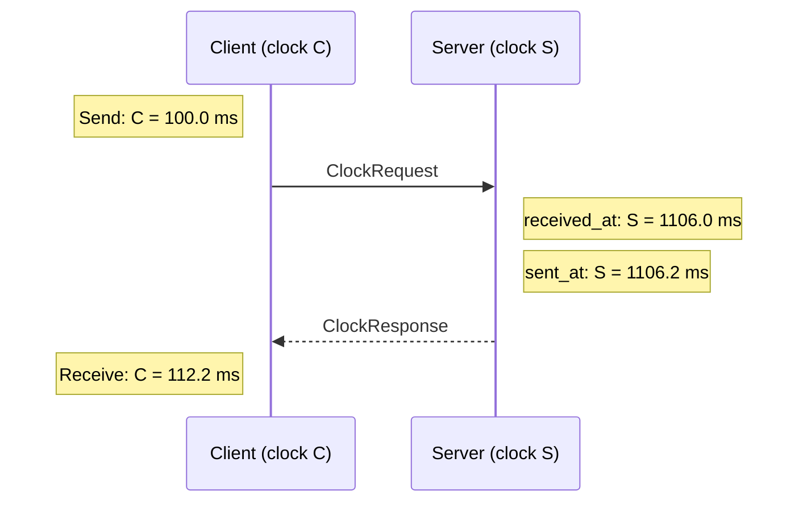

# PRO-0021: Clock offset estimation

**Tags**: protocol, transport

## Description

`ClockRequest` and `ClockResponse` provide best-effort clock offset and round-trip delay estimation using the four-timestamp method in [RFC 5905, section 8](https://www.rfc-editor.org/rfc/rfc5905.html#section-8).

### ClockRequest

Client-to-server request over the `unreliable` channel, available after version negotiation.

| Field        | Type  | Description                                                   |
| ------------ | ----- | ------------------------------------------------------------- |
| `request_id` | `u32` | Client-assigned identifier, not reused within the connection. |

### ClockResponse

Server-to-client response to a `ClockRequest`, sent over the `unreliable` channel.

| Field         | Type            | Description                                           |
| ------------- | --------------- | ----------------------------------------------------- |
| `request_id`  | `u32`           | Identifier from the request.                          |
| `received_at` | `Instant`       | Server time immediately upon receiving the request.   |
| `sent_at`     | `Instant`       | Server time immediately before sending this response. |

### Example

These timestamps give an estimated clock relation `S = C + 1000 ms` and a network round-trip delay of 12 ms.
A one-way delay estimate of 6 ms assumes symmetric transit times.

## Rationale

Clock offset estimation enables clients to synchronize sample publications to their consumption.
