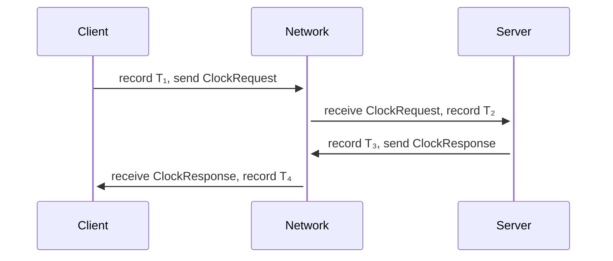

# PRO-0021: Clock offset estimation

**Tags**: protocol, transport

## Description

`ClockRequest` and `ClockResponse` provide best-effort clock offset and round-trip delay estimation using the four-timestamp method in [RFC 5905, section 8](https://www.rfc-editor.org/rfc/rfc5905.html#section-8).

### ClockRequest

Client-to-server request over the `unreliable` channel, available after version negotiation.

| Field        | Type  | Description                                                   |
| ------------ | ----- | ------------------------------------------------------------- |
| `request_id` | `u32` | Client-assigned identifier, not reused within the connection. |

### ClockResponse

Server-to-client response to a `ClockRequest`, sent over the `unreliable` channel.

| Field         | Type            | Description                                           |
| ------------- | --------------- | ----------------------------------------------------- |
| `request_id`  | `u32`           | Identifier from the request.                          |
| `received_at` | `Instant`       | Server time immediately upon receiving the request.   |
| `sent_at`     | `Instant`       | Server time immediately before sending this response. |

The measured residual offset and network round-trip delay are:

$$
\theta=\frac{(1.1060-0.1000)+(1.1062-0.1122)}{2}=1.0000\ \text{s},
$$

$$
\delta=\max\left(10^{-6},(0.1122-0.1000)-(1.1062-1.1060)\right)=0.0120\ \text{s}.
$$

Selecting this exchange for initial alignment sets $q\leftarrow q+\theta=1.0000$ seconds, keeping $f=r=0$.
The resulting software clock is $V(C)=C+1.0000$ seconds; at the reception time $C=0.1122$ seconds, its aligned value is $1.1122$ seconds.
The captured $T_1$ and $T_4$ retain their original values, and the client clears pre-alignment observations and outstanding exchanges.
A one-way delay estimate of $\delta/2=0.0060$ seconds assumes symmetric transit times.

### Client implementation guidance

A client can use a software clock with persistent phase and rate correction, following [NTP's clock discipline](https://www.rfc-editor.org/rfc/rfc5905.html#section-11.3).
Use seconds for durations and seconds per second for rates.

- $\min$: minimum of its arguments.
- $\max$: maximum of its arguments.
- $\leftarrow$: assignment; right-hand sides use the values before the assignment.

#### Software clock

- $C$: local monotonic time.
- $q$: applied offset, the correction added to local time.
- $V$: the client's estimate of server time.
- $f$: learned rate correction, retained across filter turnover and response loss ([reference frequency state](https://github.com/ntp-project/ntp/blob/9b4734a3be3659cfa890a4e11fab72a28618adcc/ntpd/ntp_loopfilter.c#L845-L859)).
- $r$: pending phase correction, the part of the measured residual still to apply ([reference phase state](https://github.com/ntp-project/ntp/blob/9b4734a3be3659cfa890a4e11fab72a28618adcc/ntpd/ntp_loopfilter.c#L962-L1000)).

$$
V(C)=C+q.
$$

Start with $q=f=r=0$ until the initial clock alignment below.
The following parameters govern how the software clock advances:

- $P$: chosen probe interval in seconds, corresponding to NTP's poll interval ([RFC 5905, section 7.3](https://www.rfc-editor.org/rfc/rfc5905.html#section-7.3)).
- $K=16$: PLL gain; the product $KP$ sets the phase-correction time constant ([reference gain](https://github.com/ntp-project/ntp/blob/9b4734a3be3659cfa890a4e11fab72a28618adcc/ntpd/ntp_loopfilter.c#L42)).
- $H=2048$ seconds: reference Allan intercept, capping the elapsed time used for rate learning ([reference constant](https://github.com/ntp-project/ntp/blob/9b4734a3be3659cfa890a4e11fab72a28618adcc/ntpd/ntp_loopfilter.c#L46)).
- $L=500\times10^{-6}$: limit on both learned rate correction and total applied correction rate ([reference limit](https://github.com/ntp-project/ntp/blob/9b4734a3be3659cfa890a4e11fab72a28618adcc/include/ntp_proto.h#L4)).
- $\operatorname{clip}$: limits its first argument to the inclusive bounds given by its second and third arguments.
- $u$: total applied correction rate, combining learned rate and phase slewing.
- $dq/dC$: rate of change of the applied offset with respect to local monotonic time.
- $dr/dC$: rate of change of the pending phase correction with respect to local monotonic time.

For probe intervals $P<H$, the [reference phase and rate adjustment](https://github.com/ntp-project/ntp/blob/9b4734a3be3659cfa890a4e11fab72a28618adcc/ntpd/ntp_loopfilter.c#L962-L1000) has the continuous rate form:

$$
u=\operatorname{clip}\left(f+\frac{r}{KP},-L,L\right),\qquad
\frac{dq}{dC}=u,\qquad \frac{dr}{dC}=f-u.
$$

Advance $q$ and $r$ to each timestamp capture or controller-update time before reading $V$ or replacing controller state.
Continue advancing the clock during response loss.

#### Measurement and initial alignment

Each exchange supplies the following quantities ([RFC 5905, section 8](https://www.rfc-editor.org/rfc/rfc5905.html#section-8)):

- $T_1$: $V$ captured immediately before sending the request.
- $T_2$: server `received_at` timestamp.
- $T_3$: server `sent_at` timestamp.
- $T_4$: $V$ captured immediately upon receiving the response.
- $\rho$: local timestamp precision, the larger of clock resolution and read time ([RFC 5905, section 6](https://www.rfc-editor.org/rfc/rfc5905.html#section-6)).
- $\theta$: residual server-minus-client offset, positive when $V$ is behind the server.
- $\delta$: network round-trip delay, excluding server processing and clamped to local precision.

Retain the captured $T_1$ when the mapping changes.
Subtract timestamps before converting differences to floating-point seconds.
Using the [corrected timestamp signs](https://errata.rfc-editor.org/eid3125/):

$$
\theta=\frac{(T_2-T_1)+(T_3-T_4)}{2},\qquad
\delta=\max\left(\rho,(T_4-T_1)-(T_3-T_2)\right).
$$

For initial alignment, select a low-delay exchange and step $q\leftarrow q+\theta$, keeping $f=r=0$.
Discard observations and outstanding exchanges from before this alignment, and initialize the previous controller-update time to the alignment time.

#### Filtering and rate learning

Keep offset, delay and monotonic reception time together in a short arrival-ordered history; [NTP uses eight exchanges](https://www.ntp.org/documentation/4.2.8-series/filter/).
Select the lowest-delay observation and accept it only if its reception time is newer than the last accepted observation.
Suppress isolated offset spikes before updating the controller ([NTP reference filter](https://github.com/ntp-project/ntp/blob/9b4734a3be3659cfa890a4e11fab72a28618adcc/ntpd/ntp_proto.c#L3471-L3507)).

- $e$: residual offset of the accepted observation, used as the controller input.
- $\mu$: elapsed monotonic time since the previous accepted controller update ([reference update interval](https://github.com/ntp-project/ntp/blob/9b4734a3be3659cfa890a4e11fab72a28618adcc/ntpd/ntp_loopfilter.c#L568)).

Compute $\mu$ before replacing the previous update time ([erratum 8215](https://errata.rfc-editor.org/eid8215/)).
After advancing the software clock to the update time, apply the [reference PLL](https://github.com/ntp-project/ntp/blob/9b4734a3be3659cfa890a4e11fab72a28618adcc/ntpd/ntp_loopfilter.c#L698-L725), then record the update time:

$$
f\leftarrow\operatorname{clip}\left(f+\frac{e\min(\mu,H)}{(4KP)^2},-L,L\right),\qquad r\leftarrow e.
$$

Validate gains and correction limits at the chosen probe cadence.
Reinitialize after a clock step or origin change.

## Rationale

Clock offset estimation enables clients to synchronize sample publications to their consumption.
