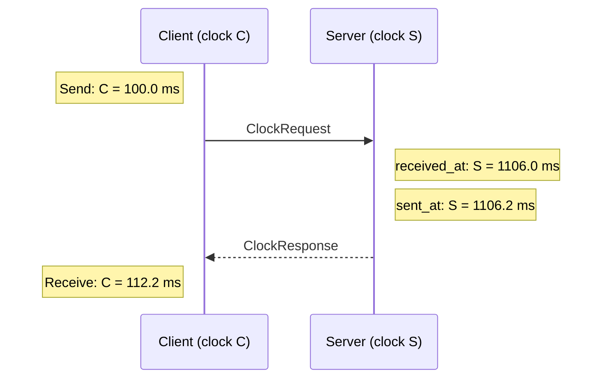
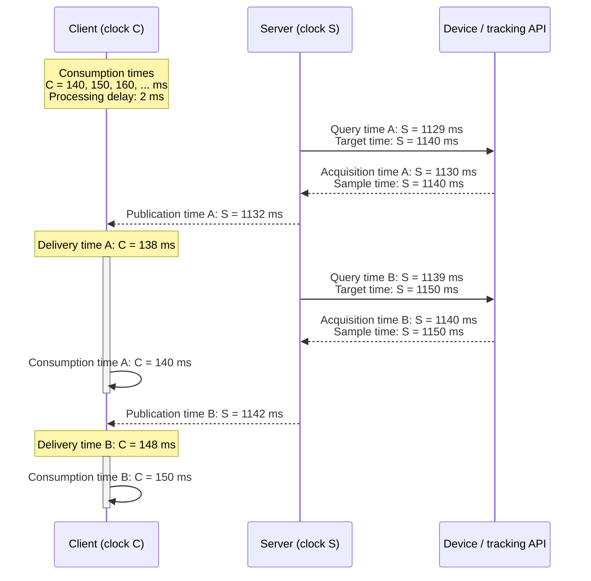

# PRO-0030: Sample timing

**Tags**: protocol

## Description

### Instants

| Instant                    | Variable                     | Clock  | Meaning                                                           |
| -------------------------- | ---------------------------- | ------ | ----------------------------------------------------------------- |
| Query time                 | `query_time`                 | Server | When the server requests samples from the device or tracking API. |
| Target time                | `target_time`                | Server | The time the sample values are requested to represent.            |
| Acquisition time           | `acquisition_time`           | Server | When the server obtains the sample group's values.                |
| Sample time                | `sample_time`                | Server | The time represented by the returned sample values.               |
| Scheduled publication time | `scheduled_publication_time` | Server | When the server is requested to send a publication.               |
| Publication time           | `publication_time`           | Server | When the server sends a publication.                              |
| Delivery time              | `delivery_time`              | Client | When the client receives a publication.                           |
| Consumption time           | `consumption_time`           | Client | When the client uses the sample values.                           |

### Durations and offsets

| Duration or offset   | Variable               | Meaning                                                                                              |
| -------------------- | ---------------------- | ---------------------------------------------------------------------------------------------------- |
| Acquisition duration | `acquisition_duration` | Time from query to acquisition.                                                                      |
| Preparation delay    | `preparation_delay`    | Time from acquisition to publication.                                                                |
| Transit delay        | `transit_delay`        | Time from publication to delivery.                                                                   |
| Processing delay     | `processing_delay`     | Time needed by the client to process delivered samples before consumption.                           |
| Arrival margin       | `arrival_margin`       | Additional time reserved before consumption to accommodate variations in delivery and processing.    |
| Publication interval | `interval`             | Desired time between successive publications ([PRO-0026](./PRO-0026.md)).                            |
| Publication phase    | `publication_phase`    | Offset of the publication cadence from the server clock's origin ([PRO-0026](./PRO-0026.md)).        |
| Prediction offset    | `prediction_offset`    | Time from scheduled publication to target time ([PRO-0026](./PRO-0026.md)).                          |
| Age at delivery      | `age_at_delivery`      | Time from acquisition to delivery, after mapping both instants to the same clock.                    |
| Age at consumption   | `age_at_consumption`   | Time from acquisition to consumption, after mapping both instants to the same clock.                 |
| Clock offset         | `clock_offset`         | Signed difference between server and client clock readings at the same instant: server minus client. |

### Example: clock offset estimation



These timestamps give an estimated clock relation `S = C + 1000 ms` and a network round-trip delay of 12 ms ([PRO-0021](./PRO-0021.md)).
A one-way delay estimate of 6 ms assumes symmetric transit times.

### Choosing a publication schedule

A client can work backwards from consumption time using estimated delays:

```text
Server clock
    scheduled_publication_time                                                                target_time
                 |                                                                                 |
                 |<------------------------------ prediction_offset ------------------------------>|
                 |                                                                                 |
                 |<----- transit_delay ----->|<--- processing_delay ---->|<--- arrival_margin ---->|
                                             |                                                     |
                                       delivery_time                                       consumption_time
Client clock
```

```text
Server clock
    n * interval               scheduled_publication_time            next scheduled_publication_time
          |                                 |                                       |
          |<------ publication_phase ------>|<------------- interval -------------->|
```

```text
target_time = consumption_time + clock_offset
prediction_offset = transit_delay + processing_delay + arrival_margin
scheduled_publication_time = target_time - prediction_offset
publication_phase = scheduled_publication_time mod interval
```

The server accounts for acquisition duration and preparation delay when choosing its query time.

### Example: periodic publication

The client consumes samples every 10 ms (100 Hz), at `C = 140, 150, 160, ... ms`.
For this example, it estimates a processing delay of 2 ms and uses an arrival margin of 0 ms.
With a transit delay of 6 ms, it can choose `prediction_offset = 6 + 2 = 8 ms`.

The clock mapping `S = C + 1000 ms` makes the first target `S = 1140 ms`.
Publication is therefore scheduled at `S = 1140 - 8 = 1132 ms`, giving `publication_phase = 1132 mod 10 = 2 ms` ([PRO-0026](./PRO-0026.md)).

| Setting             | 20 ms offset | Computed example |
| ------------------- | ------------ | ---------------- |
| `interval`          | 10 ms        | 10 ms            |
| `publication_phase` | 0 ms         | 2 ms             |
| `prediction_offset` | 20 ms        | 8 ms             |

A 20 ms prediction offset gives phase 0, with 12 ms of additional waiting at the client.
With an acquisition duration of 1 ms and a preparation delay of 2 ms, the server queries 3 ms before scheduled publication.



### Measuring freshness

Clients can estimate acquisition age using a publication's `acquired_at` as `acquisition_time` ([PRO-0028](./PRO-0028.md)):

```text
age_at_delivery = delivery_time - (acquisition_time - clock_offset)
age_at_consumption = consumption_time - (acquisition_time - clock_offset)
```

For sample A, acquisition maps to `C = 1130 - 1000 = 130 ms`.
Its age is `138 - 130 = 8 ms` at delivery and `140 - 130 = 10 ms` at consumption.
