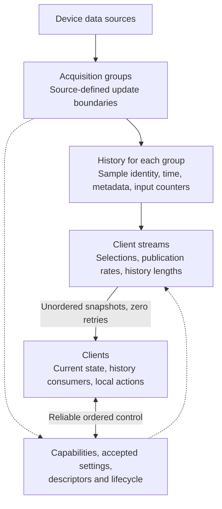

# XR tracking protocol design

**Agents: modify this file only when the user explicitly requests changes to `protocol/PROTOCOL.md`. Suggest updates to this document when we change core ideas. Implementation details should stay out.**

This document defines the device-independent requirements for publishing XR
controller inputs, poses, and body tracking. It describes what clients can rely
on: capability discovery, acquisition and publication, sample identity, timing,
metadata, and lifecycle. Device APIs, polling loops, storage structures, resource
limits, and client rendering policies belong in implementation documentation.

The priority is fresh input with low latency. A client must be able to use a new
sample without waiting for a missing older message. Loss recovery must not stall
live tracking or require an acknowledged chain of state changes.

The [wire-format document](README.md) records the supported protocol version,
encoding, and gaps between this design and the implemented contract. Backend
choices and measured limits are documented with the [server](../operator/README.md)
and [client](../viewer/README.md). Implementation defaults must not become universal
protocol requirements merely because one device currently uses them.

## Responsibilities and acquisition boundaries

The server maps device capabilities to stable, typed protocol controls and pose
sources. Clients interpret those definitions and map them to application actions
locally. Common controls retain their meaning across devices; optional controls
extend the vocabulary without requiring device-specific bindings in each client.
Device labels and profile names are supplementary information, not substitutes
for control definitions or evidence of current activity.

An **acquisition group** identifies data obtained at a shared snapshot or update
boundary. It owns a sample sequence and acquisition history. Grouping follows the
source's actual acquisition boundaries: one group may supply several data kinds,
and independently acquired data has independent groups. Groups may be periodic,
fixed to a device cadence, or event-driven. The protocol requires neither a
universal acquisition frequency nor uniform spacing between samples.

A **client stream** publishes a selection of acquired data to one client, with
its own publication settings and message sequence. Selecting a different subset,
adding a peer, or changing publication rate must not duplicate compatible device
acquisition work or create separate counters for the same physical input.
Application action mappings do not affect acquisition sharing.

This diagram describes responsibilities, not threads or storage structures. The
history node represents independent histories for independent groups. Controller,
pose, and body are payload kinds; they do not prescribe acquisition grouping or
require separate physical network connections.

## Discovery, configuration, and lifecycle

### Connect and discover

Establish a mutually supported protocol version and server session identity before
accepting stream requests or interpreting tracking. These remain immutable context
for both channels on that connection. Incompatibility receives an explicit result.
A server restart changes session identity; a new connection establishes its context
again even when the server session has continued.

The server publishes complete capability snapshots over reliable ordered control.
Apply them in receive order; a separate discovery revision counter is unnecessary.
Discovery updates do not silently change accepted stream descriptors.

Capabilities describe the data and choices the server can actually provide:

- Data kinds and sources; stable input identifiers, meanings, types, units, and ranges.
- Acquisition groups and which sources share their sample sequences.
- Supported acquisition modes and settings, including fixed cadence or event-driven
  operation where applicable; reference spaces and body joint sets.
- Publication defaults and limits, available history, message-size limits, and
  relevant resource or availability restrictions.

| Concept | Meaning |
| --- | --- |
| Supported | The server can expose the capability under the advertised configuration. |
| Selected | An accepted stream includes the capability in its descriptor and samples. |
| Active | A particular sample has a contributing input source. |

Support does not guarantee current activity or tracking validity. Unsupported or
unselected data is absent from the stream definition; selected but inactive data
remains explicitly inactive. Neither absence nor inactivity means a valid zero.

### Request and accept

A request selects known sources or controls and supported acquisition and
publication settings. All explicitly selected sources are required. Reject empty,
duplicate, unknown, or unsupported selections with a reason. Resolve omitted
settings using defined defaults and return the resolved settings explicitly;
rejection must leave existing streams unchanged.

The accepted descriptor identifies the selection, the acquisition group for each
sample sequence, accepted and effective acquisition settings, payload ordering
and interpretation, and required metadata identities. A receiver must be able to
determine which samples share a sequence. Acceptance is not a guarantee of physical sensor frequency,
continuous validity, achieved scheduling frequency, or tracking quality.

| Scope | Responsibility |
| --- | --- |
| Acquisition group | Source update boundary, acquisition settings, numbered samples, and shared history. |
| Client stream | Selected data, publication rate, history length, and message sequence. |
| Server policy | Resource budgets and device-wide settings that a client request must not silently override. |
| Client application | Action mappings, rendering/consumption cadence, and stale-input policy. |

Expose only acquisition choices that are supported and have defined semantics.
A device with a fixed cadence can advertise that constraint without offering rate
control. Publication settings remain independent per stream within advertised
limits; the protocol imposes no universal acquisition or publication ceiling.

Multiple consumers of a group require an explicit rate-arbitration contract. That
contract must define how requests combine or conflict, how accepted and effective
settings are reported, and what happens when consumers join, update, or leave.
Do not silently change another consumer's accepted configuration. A policy such as
choosing the highest requested rate must be explicit; creating a polling loop per
subscriber does not resolve shared acquisition. The exact arbitration policy remains
a [design decision](#remaining-design-decisions); these requirements do not authorize
adding speculative negotiation machinery.

### Start, change, and stop

On acceptance, deliver the stream descriptor and required metadata over control.
Publication does not wait for a client acknowledgement. Control ordering does not
extend to the tracking channel: a sample can arrive before its descriptor or
metadata. Discard samples that cannot yet be interpreted; reliable control and
subsequent fresh samples allow progress without blocking tracking. Preserve metadata
needed to interpret retained history.

A stream's selection and interpretation remain fixed. Publication-only updates
acknowledge the same stream and affect no other consumer. Changing the selection
requires closing the stream and opening a new one. A rejected update preserves the
previous settings. Capability announcements alone cannot reinterpret existing samples.

Report capability loss explicitly and close affected streams if their required data
can no longer be provided. Temporary inactivity is sample state, not automatically
a capability loss. Other streams continue independently. Discovery can announce
restored support; automatic resubscription is a client policy.

Disconnecting or unsubscribing removes that client's streams without resetting
acquisition identities or counters still used by others. Reconnection obtains new
streams, descriptors, and metadata, and baselines current input state. Data from a
retired connection must never update a new connection's state. A server restart
invalidates old identities and clock mappings. Resume and reference-space changes
must be represented consistently across acquisition groups, including retained
samples acquired before the change.

## Tracking data and interpretation

### Controller inputs and transition counters

Expose Boolean, scalar, and two-dimensional controls with stable meanings. Describe
units, ranges, and Boolean interpretation in the definitions. Normalized values
must follow their declared range; active numeric values must be finite. Unfamiliar
optional controls can be inspected or ignored without assigning application actions.

Each selected Boolean includes current state, activity, and cumulative press and
release counts. Counts represent observed false-to-true and true-to-false
transitions; the same convention applies to touch or proximity states. Count once
at acquisition, independently of publication. Repeated reads of the same source
snapshot and repeated publication must not count a transition again. All consumers
of that input share its counts, regardless of their selected subsets.

Use source change information when available. Where only state snapshots are
available, transitions can be inferred only between observed active states. Neither
method guarantees recovery of physical transitions the source never exposed.
Activity loss and reacquisition do not invent button edges: retain counts and
rebaseline the active state. Attaching or detaching a consumer does not reset counts.

The first live sample establishes a client baseline rather than replaying historical
actions. Later counter differences can recover observed presses and releases omitted
from delivered state snapshots, even when the current state ends unchanged. Apply
each advance once; do not sum overlapping history again. Counters do not establish
exact event times or ordering between different inputs. Applications decide whether
recovered transitions are still useful for their current interaction.

### Poses and body data

Pose sources have stable identifiers and meanings. Each located pose carries position
and orientation, independent validity and tracking flags for each, its reference-space
version, and timing information. Include source activity where available; an absent
activity flag is different from false. A valid inferred or retained pose need not be
actively tracked. Invalid transforms must not be interpreted as real tracking.

Body samples identify their joint set and exact skeleton version and carry joint
poses, per-joint validity/tracking flags, and overall activity. Include available
confidence, actual quality/fidelity, and calibration status with defined meanings;
unavailable status is absent. Confidence, when present, is finite in [0,1]. Actual
status does not require a separate inclusion switch. A requested quality preference
is not a guarantee of achieved quality or independently measured motion.

Each sample is a complete snapshot of the stream's selected data. Input and pose
arrays match descriptor definitions; body joints match the referenced skeleton.
Unchanged values remain present. Missing data never instructs a receiver to reuse
a value from a previous packet.

### Coordinates and versioned metadata

All geometry uses right-handed coordinates: +X right, +Y up, and -Z forward.
Positions use metres. Quaternions use (x,y,z,w) order, rotate local coordinates into
the named reference frame, and are finite unit quaternions when valid. These
conventions apply to poses, body joints, and skeleton rest geometry. They are fixed
protocol conventions, not per-client options.

Reference spaces and skeletons have identities described over control; no numeric
identity has a universal device-specific meaning. A descriptor fixes the identities
used by its stream. Samples refer to the versions in effect at acquisition, and
versions must never be reused for different meanings or contents. Skeletons define
joint identifiers, an acyclic parent hierarchy, and rest geometry in a declared
reference frame. Parent links do not make joint poses implicitly parent-relative.

A recenter or other reference-frame discontinuity must be distinguishable from
physical motion. Retained samples keep their original reference and skeleton
versions; they must not be relabeled with current versions. All affected groups
must describe the same frame change consistently, even when acquired at different
times. Receivers must not assume continuity across a change without an explicit
relationship between the frames. Whether to provide continuity transforms remains
a design decision; versioning alone does not supply one.

## Identity, history, and delivery

### Sample and message identity

| Identity | Scope |
| --- | --- |
| Server session | One server lifetime, shared across its peers. |
| Acquisition group | One identifiable acquisition sequence within the session. |
| Sample number | Advances once per acquisition in that group, shared by every consumer of the sample. |
| Client stream | One client's selected publication; a recreated stream gets a new identity. |
| Message number | Advances for each publication accepted for transport on that stream. |

A sample's logical identity is (server session, acquisition group, sample number).
A message's identity is (server session, stream, message number). Context may supply
parts of these identities without repeating them in every message. Identities must
not be reused or counters wrapped within their scope. A new acquisition sequence
requires a distinct identity so receivers cannot mistake it for old history.

Assign sample identity at acquisition. Repeating a retained sample preserves its
identity, timestamps, metadata versions, and values. Publishing an older body result
alongside newer pose or input data does not create a new body acquisition. Numbers
from unrelated groups do not imply simultaneity; use timestamps to correlate them.
Even within a shared snapshot, sample identity does not prove simultaneous physical
sensor captures. Device updates, application acquisitions, and publications are
separate quantities.

Assign message numbers only when transport accepts a publication. Skipped sends,
replaced unsent data, and synchronous send rejection consume no number. Acceptance
does not prove delivery. Control requests and clock probes have separate identities
and do not consume tracking sample or message numbers.

### Acquisition history

Each tracking message carries a nonempty array of samples of one payload kind and
one acquisition group. History length counts the newest sample as well as older
samples, with a minimum of one. Include up to the accepted length of the latest
consecutive acquisitions of that group, oldest to newest. Acquisition timestamps
are nondecreasing; sample spacing need not be uniform.

History contains acquisitions, not merely previous publications. Never wait to fill
history before publishing. Retention and message-size limits bound what can be
provided. If a group cannot supply a complete selected snapshot for an acquisition,
history must not bridge that gap while claiming consecutive samples. Do not mix
acquisition identities or fabricate intermediate samples to fill a history.

Overlapping history intentionally repeats samples to improve coverage without
waiting for loss reports or acknowledgements. Repeated entries remain immutable.
A finite history cannot guarantee recovery through an arbitrarily long outage;
a lower publication rate can also omit acquisitions when history is too short.

### Reliability, congestion, and consumption

| Channel | Delivery | Purpose |
| --- | --- | --- |
| Control | Reliable, ordered | Discovery, requests/results, descriptors, metadata, and lifecycle. |
| Tracking | Unordered, zero retries | Self-contained sample histories and clock probes/replies. |

Unordered delivery alone does not disable retransmission. There are no per-snapshot
acknowledgements, requests for missing tracking packets, or decoding dependencies
on earlier packets. Separate channels must not be assumed to isolate congestion,
and zero retries does not guarantee a maximum delivery delay.

Keep pending data bounded and prefer fresh samples over queued obsolete publications.
Larger payloads must not indefinitely starve other active streams. Exact scheduling,
buffering, and transport resource limits belong to the implementation and advertised
capabilities. Validate messages before changing live state; invalid tracking cannot
advance counters or freshness. Invalid control that prevents safe interpretation
terminates the connection; a valid but unsupported request receives a rejection.

Live consumers apply only samples newer than their last applied sample in the same
acquisition sequence. History consumers may separately retain unseen older samples.
Reordered messages must never roll live state backward. Keep these observations
separate when reporting statistics:

- A message gap is a publication not yet received; it can be lost or merely reordered.
- A sample gap is missing acquisition coverage, which can also result from publication
  rate or insufficient history. Inspect every history entry, not just the newest.
- Consumer coalescing replaces pending updates deliberately; it is not network loss.

Expire stale state when fresh acquisitions stop arriving. Republishing retained data
does not refresh its acquisition age. Inactive input and stale input remain distinct
from an observed release; cancelling an interaction locally must not change server
transition counts. Staleness thresholds and rendering cadence are client policies.

## Timestamping and clock synchronization

### Timestamp meanings

All server timestamps use one monotonic clock domain shared across groups and peers,
with an opaque origin scoped to the server session. Clients cannot configure this
domain and it need not be advertised. Timestamps use signed integer nanoseconds and
must be preserved exactly; nanosecond units do not guarantee nanosecond accuracy.
They are not UTC and cannot be compared directly with another session or client clock.

| Timestamp | Meaning |
| --- | --- |
| Acquisition time | When the application acquired the sample; not necessarily sensor capture time. |
| Target time | The time requested for a pose or estimate, potentially in the future. |
| Returned-data time | The time represented by a returned result; not necessarily a new sensor observation. |
| Input-change time | A source-reported change time, when available and valid. |
| Probe receive/send time | The application's receive/send boundary for clock synchronization. |

Convert source timestamps into the server domain before publishing them. Unknown,
invalid, or unconvertible times remain absent; absence differs from zero. Do not
substitute query completion time for an unknown source time. Every publication of a
sample preserves the same timestamps. Subtracting a predicted target time from
arrival time does not measure acquisition latency.

### Clock mapping

Use a four-timestamp exchange on the tracking channel. The client retains its send
time t1 with a probe ID; the server returns receive time t2 and send time t3; the
client records receive time t4 and matches the reply. Record these times close to
the application send/receive boundaries. Lost probes do not block tracking, require
retries, or enter sample histories.

For approximately equal clock rates during an exchange, in consistent units:

| Quantity | Calculation |
| --- | --- |
| Offset, server minus client | ((t2 - t1) + (t3 - t4)) / 2 |
| Round trip excluding server processing | (t4 - t1) - (t3 - t2) |
| Approximate local time of a server timestamp | server timestamp - offset |

The offset estimate assumes approximately symmetric path delays. A small round trip
is not proof of symmetry or a particular accuracy. Application scheduling and
transport queues affect the exchange; these are not hardware packet timestamps.

Refresh estimates, favor recent low-delay exchanges, reject invalid observations,
and account for drift, estimate age, and uncertainty. Probe cadence, filter size,
and expiry tuning are client policies. Invalidate mappings on session changes and
suspend/resume or clock discontinuities; discard exchanges spanning those changes.
A clock mapping is scoped to its connection and server session.

Tracking can continue without a usable mapping: identities still order samples
within a group, but local sample age and one-way latency remain unknown. A timestamp
or estimated age alone does not qualify data for hardware actuation.

## Remaining design decisions

The following need an explicit contract before implementing configurable shared
acquisition. They are not permission to infer behavior from a particular backend:

- How concurrent acquisition-rate requests combine, including admission, conflicts,
  effective-rate changes, notification ordering, and behavior when consumers leave.
- How fixed-cadence and event-driven acquisition choices and effective settings are
  represented, and how group identities survive suspension or acquisition restarts.
- Whether frame changes carry continuity transforms, and how their effective boundary
  is represented consistently across asynchronously acquired groups.

Supported choices must be specified and implemented together. The
[wire-format status](README.md#design-and-implementation-status) records what is
implemented; this document does not assert that every design requirement is already
supported by the current wire version.
