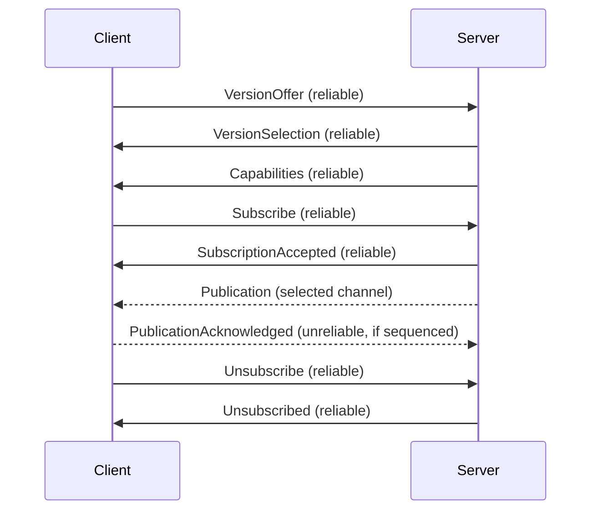

# Transport and sessions

## Channels

A connection provides two logical channels in each direction.
The transport binding keeps data from different connections separate.

| Channel      | Delivery                                             |
| ------------ | ---------------------------------------------------- |
| `reliable`   | Ordered, guaranteed delivery, or connection failure. |
| `unreliable` | Unordered delivery without retransmission.           |

Both channels preserve message boundaries and carry the same [tag-and-payload encoding](encoding/messages.md).
Each complete protocol message MUST fit one transport message including its tag; publications' maximum sizes with every bundle present are checked when admitting subscriptions on either channel.
Each publication is independently decodable using its accepted subscription and capabilities.
The reliable channel carries control and reliable publications; the unreliable channel carries unreliable publications, publication acknowledgments and clock exchanges.

The transport must provide the two delivery behaviors independently; putting both behind one reliable ordered stream does not provide unreliable delivery.
Transport establishment and platform integration are binding-specific.
The [operator binding](bindings/operator.md) defines the current WebRTC message limit and source-quality policy.

## Session lifecycle

The client sends a version offer, the server selects a version, and the server advertises capabilities.
The client then requests subscriptions.

The negotiated version applies to both channels for the connection.
Only negotiation messages carry a protocol version.
Capabilities supply the indices and layouts used by subsequent requests and publications.
Subscriptions, timing, bundle and acknowledgment state, and pending operations belong to the connection and are discarded when it ends.
A new connection repeats negotiation and discovery.

Server send order does not establish arrival order across channels.
An unreliable publication for a new id can overtake its acceptance and is discarded until the id is accepted.
Reusing an id has the ambiguity described in [replacement](interactions/05-replacement.md#unreliable-id-reuse).
Reliable publications follow their acceptance in the same ordered channel.

## Samples and mappings

A [SampleDescriptor](types/SampleDescriptor.md) identifies a selectable sample, its kind, formats and acquisition group.
Optional descriptor references associate input states with counters and poses with quality samples.
[Joint](types/Joint.md) references associate live and rest-pose samples with a parent within a [Skeleton](types/Skeleton.md).
Subscriptions select bundles of samples from one group and establish their order and representations.
Bundle 0 is included every time; other bundles deliver their latest changed state until acknowledged.

## Invalid messages

The following outcomes apply before changing active subscription state.
The Subscribe and UpdateSchedule rows describe messages on their required Reliable channel; invalid control received on Unreliable is always discarded.

| Condition | Outcome |
| --------- | ------- |
| Truncated or trailing bytes, invalid UTF-8, impossible counts, unknown tags, invalid enum values or required absence sentinels in reliable control | End the connection. |
| Control received on Reliable in the wrong direction, in an invalid phase, or with a type forbidden on that channel; invalid capability advertisement | End the connection. |
| Subscribe with zero interval, no bundles, multiple bundles without a sequence format, or an unknown descriptor needed to decode a binding | End the connection. |
| Structurally valid Subscribe with unknown group, group mismatch, unsupported advertised format/space, or an unfulfillable source, size or rate request | Send SubscriptionRejected; preserve any existing subscription. |
| Malformed Publication, unknown/retired subscription id, wrong publication channel, or an ambiguous sequence | Discard the publication on either channel without applying values or acknowledging it. |
| Malformed, unknown or unexpected unreliable control, including an acknowledgment with no matching subscription/sequence | Discard the message. |
| Valid UpdateSchedule for an unknown or ended id | Ignore the update. |
| Valid UpdateSchedule for an active id that exceeds admission limits | Terminate that subscription with Unsubscribed and a reason. |

Reserved enum values are type errors even when the remaining bytes are readable.
For example, Channel `0x03` and sequence-format `0x04` close a reliable connection, whereas defined SampleFormat `0x04` requested from a bit-only descriptor is a subscription rejection.
Zero or the absent sentinel is invalid for a required positive interval, including in UpdateSchedule.
Malformed UpdateSchedule ends the connection even if its id is unknown; validate its structure and timing before looking up the id.
A reliable control message exceeding the receiver's decoding bound ends the connection; a fully readable request whose maximum publication would exceed the delivery bound is rejected.

Requirements: [PRO-0002](../design/requirements/protocol/PRO-0002.md), [PRO-0004](../design/requirements/protocol/PRO-0004.md), [PRO-0005](../design/requirements/protocol/PRO-0005.md), [PRO-0006](../design/requirements/protocol/PRO-0006.md), [PRO-0012](../design/requirements/protocol/PRO-0012.md), [PRO-0013](../design/requirements/protocol/PRO-0013.md), [PRO-0014](../design/requirements/protocol/PRO-0014.md), [PRO-0016](../design/requirements/protocol/PRO-0016.md), [PRO-0017](../design/requirements/protocol/PRO-0017.md), [PRO-0018](../design/requirements/protocol/PRO-0018.md), [PRO-0019](../design/requirements/protocol/PRO-0019.md).
