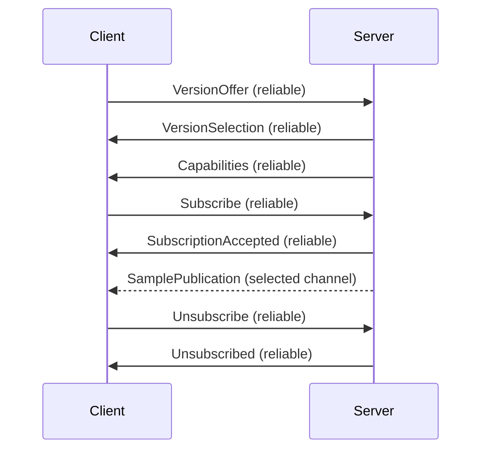

# Transport and sessions

## Channels

A connection provides two logical channels in each direction.
The transport binding keeps data from different connections separate.

| Channel      | Delivery                                             |
| ------------ | ---------------------------------------------------- |
| `reliable`   | Ordered, guaranteed delivery, or connection failure. |
| `unreliable` | Unordered delivery without retransmission.           |

The reliable channel carries [framed records](encoding/reliable.md), including control messages and reliable sample publications.
The unreliable channel preserves message boundaries and carries [tagged messages](encoding/unreliable.md) for sample publications and clock exchanges.
An unreliable publication is independently decodable using its accepted subscription and capabilities.
It MUST fit one transport message including its tag; its maximum size is checked when admitting the subscription.
Reliable records can span transport writes or messages and are reassembled using their length prefix.

The transport must provide the two delivery behaviors independently; putting both behind one reliable ordered stream does not provide unreliable delivery.
Transport establishment and platform integration are binding-specific.

## Session lifecycle

The client sends a version offer, the server selects a version, and the server advertises capabilities.
The client then requests subscriptions.

The negotiated version applies to both channels for the connection.
Only negotiation messages carry a protocol version.
Capabilities supply the indices and layouts used by subsequent requests and publications.
Subscriptions, schedules and pending operations belong to the connection and are discarded when it ends.
A new connection repeats negotiation and discovery.

Server send order does not establish arrival order across channels.
An unreliable publication for a new id can overtake its acceptance and is discarded until the id is accepted.
Reusing an id has the ambiguity described in [replacement](interactions/05-replacement.md#unreliable-id-reuse).
Reliable publications follow their acceptance in the same ordered channel.

## Samples and mappings

A [SampleDescriptor](types/SampleDescriptor.md) identifies a selectable sample, its kind, formats and acquisition group.
Optional descriptor references associate input states with counters and poses with quality samples.
[Joint](types/Joint.md) references associate live and rest-pose samples with a parent within a [Skeleton](types/Skeleton.md).
Subscriptions select samples from one group and establish their value order and representations.

## Invalid messages

Malformed reliable framing, unknown reliable tags, invalid advertisements and reliable messages in an invalid phase end the connection.
Malformed or unexpected unreliable messages are discarded.
A structurally readable subscription request that cannot be fulfilled receives [SubscriptionRejected](types/SubscriptionRejected.md).
A malformed publication is discarded without exposing its values.
Unknown or retired subscription ids are discarded before their publication values are decoded.

Requirements: [PRO-0002](../design/requirements/protocol/PRO-0002.md), [PRO-0004](../design/requirements/protocol/PRO-0004.md), [PRO-0005](../design/requirements/protocol/PRO-0005.md), [PRO-0006](../design/requirements/protocol/PRO-0006.md), [PRO-0012](../design/requirements/protocol/PRO-0012.md), [PRO-0013](../design/requirements/protocol/PRO-0013.md), [PRO-0014](../design/requirements/protocol/PRO-0014.md), [PRO-0016](../design/requirements/protocol/PRO-0016.md), [PRO-0017](../design/requirements/protocol/PRO-0017.md), [PRO-0018](../design/requirements/protocol/PRO-0018.md), [PRO-0019](../design/requirements/protocol/PRO-0019.md).
