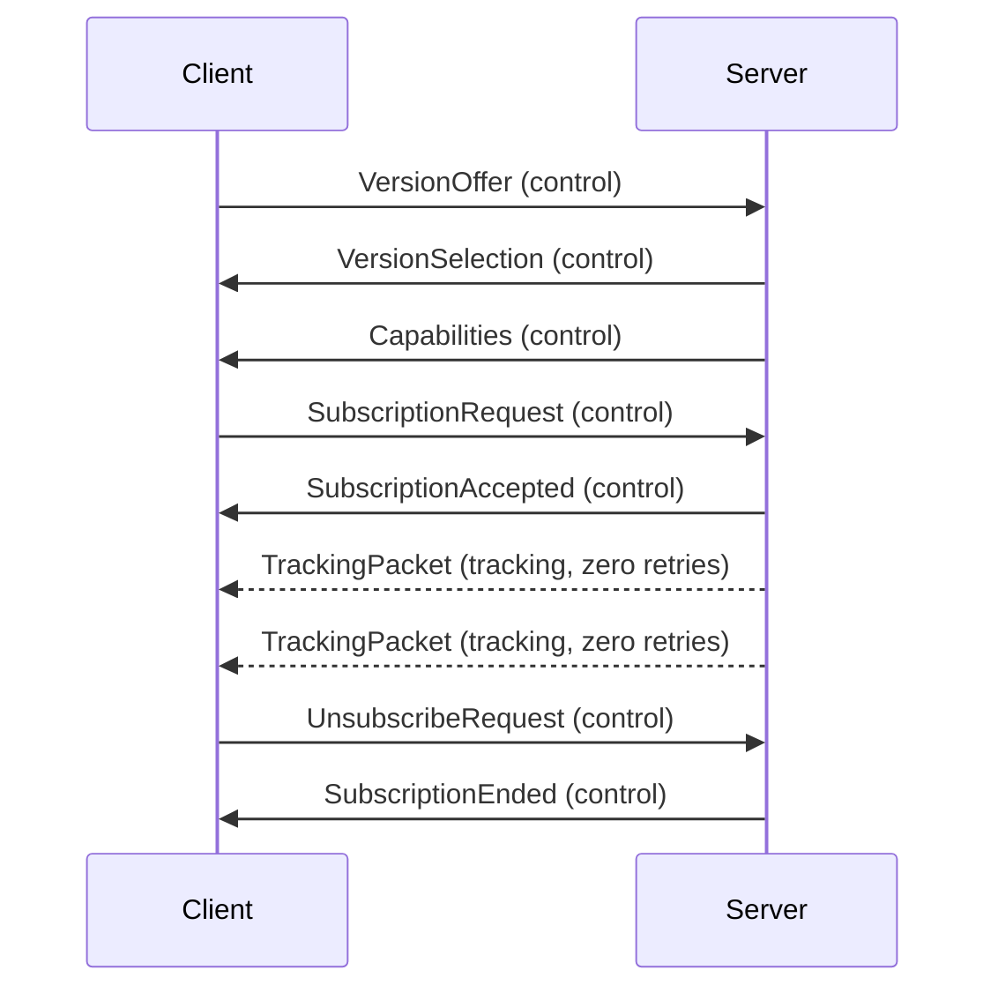

# Transport and sessions

## Required transport behavior

A connection supplies two logical channels belonging to the same session.
The transport binding MUST keep data from different connections separate, including after reconnecting.

| Channel | Information | Delivery requirement |
| --- | --- | --- |
| Control | Negotiation, capabilities, subscription requests, acceptance, rejection, unsubscription, and termination reasons | Reliable, ordered delivery in each direction, or connection failure |
| Tracking | Current sample values, availability, cumulative edge counters, and acquisition timestamps | Unordered, zero retransmissions, no acknowledgement prerequisite |

Tracking delivery MUST NOT wait for recovery of an earlier tracking packet or a lost control message.
A transport that puts both channels behind one reliable ordered delivery stream does not satisfy this requirement.
An implementation MUST NOT add application-level tracking retries or acknowledgements.
If sending falls behind, discard superseded tracking samples instead of preserving a backlog.

Control uses the [length-prefixed framing](encoding/control.md) defined here, whether carried in a stream or by a message transport.
Tracking requires a transport that preserves individual packet boundaries.
Each publication MUST fit one tracking transport message; this protocol does not split a publication into dependent fragments.
The server MUST reject a subscription whose maximum encoded packet would exceed its transport's message limit.

The specification defines transport capabilities rather than selecting a particular transport product or connection-establishment mechanism.

## Session lifecycle

Each connection starts without negotiated state.
The client offers versions, the server selects one, and the server advertises capabilities.
Only then can the client request subscriptions.
Accepted subscriptions produce independent tracking packets.

The diagram shows server send order, not arrival order between channels.
Tracking can arrive before its acceptance message and is discarded until the client has the corresponding interpretation metadata.
Later packets remain independently usable.

The negotiated version applies to both channels until disconnection.
The server MUST NOT transmit tracking before successful negotiation and acceptance of a subscription.
Only negotiation messages contain version numbers.

Capabilities and their list indices are fixed for the connection.
All subscription state, generation identifiers, acquisition timestamps, and decoder layouts belong to that connection.
When either required channel fails, both peers MUST retire the session and discard its state.
A new connection repeats negotiation, discovery, and subscription, including after a server restart.
Persisted device-stable sample identifiers can help the client choose from the new advertisement, but previous indices and subscriptions cannot be reused as negotiated state.

## Interpreting samples

A [SampleDescriptor](types/SampleDescriptor.md) describes an individually selectable value.
Its [SampleKind](types/SampleKind.md) supplies semantics and component count; its [SampleFormat](types/SampleFormat.md) supplies the representation of each component.
Each body joint is selectable through its own descriptor, ordinarily with kind `pose`.
A selected pose includes a [ReferenceSpace](types/ReferenceSpace.md).

Each descriptor belongs to one [SampleGroup](types/SampleGroup.md).
A subscription selects values from just one group, so one acquisition timestamp applies to the whole packet.
Separate groups require separate subscriptions and do not imply simultaneous acquisition.

Acceptance binds the client's requested sample order, formats, and spaces to a server-assigned generation.
A tracking packet identifies that subscription and generation instead of repeating its schema.
It carries availability and complete current values, with no dependence on any earlier tracking packet.

## Invalid data

Malformed control framing, invalid bootstrap messages, invalid advertisements, unknown message tags, and messages in an invalid session phase MUST end the connection.
A syntactically readable subscription request that cannot be fulfilled receives [SubscriptionRejected](types/SubscriptionRejected.md) with a reason.
Malformed tracking packets MUST be discarded without updating the latest accepted sample or timestamp.
Unavailable data is represented by availability bits, never by an invented zero value.

Sources: [PRO-0002](../design/requirements/protocol/PRO-0002.md), [PRO-0003](../design/requirements/protocol/PRO-0003.md), [PRO-0004](../design/requirements/protocol/PRO-0004.md), [PRO-0005](../design/requirements/protocol/PRO-0005.md), [PRO-0006](../design/requirements/protocol/PRO-0006.md), [PRO-0007](../design/requirements/protocol/PRO-0007.md), [PRO-0012](../design/requirements/protocol/PRO-0012.md), and [PRO-0014](../design/requirements/protocol/PRO-0014.md).
